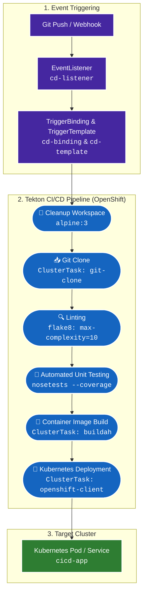

# Cloud-Native CI/CD Pipelines with Tekton & OpenShift

  
  
  
  
  
  
  

This repository contains the complete implementation of cloud-native Continuous Integration and Continuous Delivery (CI/CD) pipelines built on **Tekton**, **Red Hat OpenShift Pipelines**, and **Kubernetes**, based on the *IBM Introduction to CI/CD* curriculum.

---

## 🎯 Pipeline Architecture

The end-to-end CI/CD workflow automates every phase of the software delivery lifecycle—from code commit to Kubernetes container deployment:

---

## 📚 Labs Directory & Curriculum

| Lab | Name | Key Technologies | Description |
|:---:|:---|:---|:---|
| **01** | [Build an Empty Pipeline](labs/01_base_pipeline/) | `Tekton Task`, `Pipeline`, `PipelineRun` | Foundation pipeline structure with parameters and basic execution |
| **02** | [Adding GitHub Triggers](labs/02_add_git_trigger/) | `EventListener`, `TriggerBinding`, `TriggerTemplate` | Webhook-driven pipeline execution on git events |
| **03** | [Use Tekton CD Catalog](labs/03_use_tekton_catalog/) | `ClusterTask: git-clone`, `Workspaces` | Utilizing reusable community catalog tasks with shared storage |
| **04** | [Unit Test Automation](labs/04_unit_test_automation/) | `flake8`, `nose`, `Python 3.9` | Automated code quality linting and test coverage enforcement |
| **05** | [Building Container Images](labs/05_build_an_image/) | `ClusterTask: buildah`, Container Registries | Rootless OCI container image creation and registry push |
| **06** | [Deploy to Kubernetes](labs/06_deploy_to_kubernetes/) | `ClusterTask: openshift-client`, `oc / kubectl` | Automated rolling deployment of new images to K8s |
| **07** | [CI/CD with OpenShift Pipelines](labs/07_openshift_pipeline/) | `OpenShift Pipelines`, `PersistentVolumeClaim` | Complete unified 6-step declarative GitOps workflow |

---

## 🛠️ Tech Stack & Tooling

- **CI/CD Engines:** Tekton Pipelines, OpenShift Pipelines, GitHub Actions
- **Containerization:** Docker, Buildah, OCI Image Specification
- **Orchestration:** Kubernetes, Red Hat OpenShift
- **Testing & Quality:** Python 3.9, Flask, Flake8, Nose, Coverage.py
- **GitOps:** Declarative Kubernetes manifests (`YAML`), TriggerBindings

---

## 🧑‍💻 Author & Acknowledgements

- **Repository Owner:** [@Sairaj213](https://github.com/Sairaj213)
- **Course & Practice Material:** IBM Developer Skills Network (*Introduction to CI/CD*)
- **Instructor:** John Rofrano (DevOps Champion, Senior Technical Staff Member @ IBM Research)