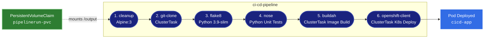

# Lab 7: CI/CD with OpenShift Pipelines (Tekton)

[](https://tekton.dev/)
[](https://www.redhat.com/en/technologies/cloud-computing/openshift)
[](https://kubernetes.io/)

This directory contains the declarative **Tekton / OpenShift Pipelines** manifests representing the end-to-end CI/CD workflow created in **Lab 7**.

---

## 🏗️ Pipeline Architecture

The `ci-cd-pipeline` orchestrates 6 sequential tasks running inside containerized steps on an OpenShift / Kubernetes cluster:



---

## 📂 Manifest Inventory

| File | Resource Kind | Purpose |
|------|---------------|---------|
| [`tasks.yaml`](tasks.yaml) | `Task` | Defines `cleanup` (workspace wiper) and `nose` (unit tests runner) |
| [`pvc.yaml`](pvc.yaml) | `PersistentVolumeClaim` | 1Gi workspace storage backed by storage class `skills-network-learner` |
| [`pipeline.yaml`](pipeline.yaml) | `Pipeline` | Declarative 6-step DAG linking cleanup, clone, lint, test, build, and deploy |
| [`pipelinerun.yaml`](pipelinerun.yaml) | `PipelineRun` | Instantiates `ci-cd-pipeline` with workspace binding and runtime parameters |

---

## 🚀 How to Run on an OpenShift / Kubernetes Cluster

1. **Apply the PersistentVolumeClaim:**
   ```bash
   kubectl apply -f pvc.yaml
   ```

2. **Install the Custom Tasks & Tekton Catalog Tasks:**
   ```bash
   kubectl apply -f tasks.yaml
   kubectl apply -f https://raw.githubusercontent.com/tektoncd/catalog/main/task/flake8/0.1/flake8.yaml
   ```

3. **Deploy the Pipeline:**
   ```bash
   kubectl apply -f pipeline.yaml
   ```

4. **Trigger a Pipeline Run:**
   ```bash
   kubectl create -f pipelinerun.yaml
   ```

5. **Track logs using Tekton CLI (`tkn`):**
   ```bash
   tkn pipelinerun logs -f -L
   ```
